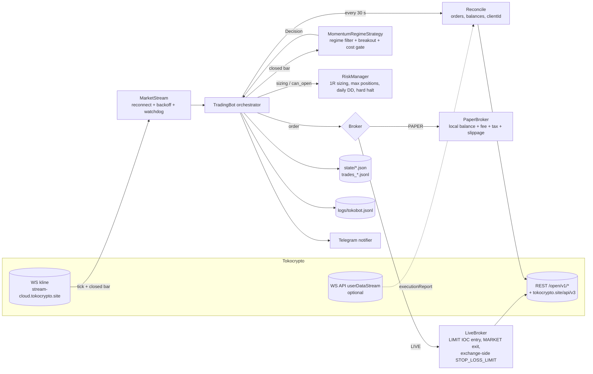

# TokoBot — Spot Trading Bot for Tokocrypto (Python, asyncio)

> Versi Bahasa Indonesia: [README.id.md](README.id.md)

A long-only spot trading bot for USDT pairs on Tokocrypto (Indonesia): **volatility breakout + market regime
filter**, fixed-risk position sizing, layered kill-switches, state reconciliation, and three modes
(`BACKTEST` / `PAPER` / `LIVE`) that run the **same** strategy and risk code.

> **Status: not recommended for real money.** The built-in strategy **failed** an edge test whose criteria were
> written in advance (lower bound of the 95% CI: −0.021R; see [Evaluation results](#1-evaluation-results)).
> This repo is useful as an execution framework and an honest evaluation pipeline, not as a money machine.

---

## 1. Evaluation results

Tested configuration (frozen before testing): **4h timeframe, 3×ATR stop, `MAX_COST_TO_RISK=0.25`**.
Costs: 0.15% fee per side (verified via the account API), 0.21% final income tax on both sides
([Finance Ministry Regulation 50/2025](https://www.pajak.go.id/artikel/pmk-502025-babak-baru-pemajakan-aset-kripto)), 0.05% slippage.

| Test data (not used when choosing parameters) | Trades | Mean R | Profit factor |
|---|---|---|---|
| BTC/ETH 2018–2021 | 87 | +0.214 | 1.63 |
| SOL, BNB, XRP, ADA 2018–2026 | 279 | +0.073 | 1.18 |
| **Combined** (95% CI, bootstrapped by entry month, 81 clusters) | **366** | **+0.106** (−0.021 to +0.228) | – |

Pass criteria written before the results: mean > 0.1R **and** lower bound of the 95% CI > 0 → **FAIL**.

Key findings:
- A gross edge exists (about 0.18–0.34R per trade), but costs take 0.10–0.12R per trade.
- The 1h timeframe is not viable: gross edge 0.05–0.12R vs. costs of 0.17–0.28R.
- 2025 and 2026 were negative across all six coins combined (−0.05R and −0.08R).
- Not yet verified: whether BUY orders on USDT pairs are taxed. If they are not, one re-run is allowed and its result is final.

Reproduce the decision test:
```bash
BACKTEST_END=2022-01-01 BACKTEST_RESULTS_DIR=results/btc_eth_2018_2021 \
  python main.py --mode BACKTEST && \
SYMBOLS=SOL_USDT,BNB_USDT,XRP_USDT,ADA_USDT MAX_OPEN_POSITIONS=4 \
  BACKTEST_RESULTS_DIR=results/alts python main.py --mode BACKTEST && \
python scripts/bootstrap_ci.py \
  results/btc_eth_2018_2021/trades_BTC_USDT-ETH_USDT_4h_research.csv \
  results/alts/trades_SOL_USDT-BNB_USDT-XRP_USDT-ADA_USDT_4h_research.csv --cluster month
```

## 2. Features

- **Tokocrypto connector:** signed REST (HMAC SHA256) with clock sync, a rate limiter (token bucket + the
  `X-MBX-USED-WEIGHT-*` headers + `Retry-After` on 429/418), and a kline WebSocket with exponential-backoff
  reconnects, a stale-data watchdog, and connection rotation before the 24-hour limit.
- **Precision:** every order is validated with `Decimal` against `tickSize`, `stepSize`, `minNotional` and
  `PERCENT_PRICE` before it is sent.
- **Idempotency:** deterministic `clientId` per bar; on a timeout or 5XX during order placement the order is looked
  up by `clientId`, never blindly resent → no double entries.
- **Exchange-side protection:** a GTC `STOP_LOSS_LIMIT` that stays active if the bot dies, plus a watchdog that exits
  at market when price gaps through it.
- **Reconciliation** every 30 seconds: unconfirmed entries, stop-order status, balances vs. positions, orphan orders.
- **Risk:** 1R sizing (costs on both sides included), max concurrent positions, daily drawdown kill-switch,
  total drawdown hard halt, losing-streak pause, manual kill file.
- **Observability:** rotating JSON Lines logs + console, non-blocking Telegram alerts, heartbeat for health checks.
- **Evaluation:** look-ahead-free portfolio backtest, three comparable simulations, per-year breakdown, costs
  measured in R, parameter sweep, clustered bootstrap CI.

## 3. System flow



Per-bar cycle (default **4h**):
1. **Tick** (~2 s): soft stop / exchange-stop watchdog, partial take-profit (TP1).
2. **Bar close**: indicators over the last 1000 bars → regime filter → breakout trigger → cost gate →
   `RiskManager.can_open` → sizing → `Broker.buy` → stop placed on the exchange.
3. **Open position**: Chandelier trailing stop updated on bar close only (same as the backtest).
4. **Risk loop** (5 s): mark-to-market → daily kill / hard halt / kill file.
5. **Reconcile loop** (30 s, LIVE).

## 4. Project structure

```
tokobot/
├── main.py                        # PAPER/LIVE orchestrator + CLI (--status, --reset-halt)
├── config.py                      # immutable config from env, cross-validated
├── .env.example
├── core/models.py                 # Candle, Position, TradeRecord, FillResult
├── exchange/tokocrypto_client.py  # signed REST, rate limiter, MarketStream, UserDataStream, SymbolRules
├── data/
│   ├── indicators.py              # EMA, ATR, ADX, Donchian, Efficiency Ratio (causal)
│   └── history.py                 # CSV load/save, resampling
├── strategy/momentum_regime.py    # regime filter + signal + stop/TP/trailing levels
├── risk/risk_manager.py           # sizing + layered kill-switches
├── execution/
│   ├── broker.py                  # PaperBroker, LiveBroker
│   └── state_store.py             # atomic JSON + trade journal
├── backtest/engine.py             # portfolio backtest, metrics, IS/OOS, data download
├── notify/telegram.py             # non-blocking async alerts
├── utils/logger.py                # console + rotating JSON Lines
├── scripts/
│   ├── preflight.py               # connectivity, symbol rules, account fee & tax
│   ├── sweep.py                   # structural parameter sweep (research mode)
│   ├── bootstrap_ci.py            # expectancy CI, --cluster month option
│   └── make_synthetic_data.py     # SYNTHETIC data for smoke tests
├── tests/                         # 35 tests: unit, backtest invariants, mock exchange REST+WS, resilience
└── deploy/                        # Dockerfile, docker-compose.yml, tokobot.service
```

Code comments, docstrings and log messages are in Indonesian.

## 5. Quickstart

```bash
python3.12 -m venv .venv && source .venv/bin/activate
pip install -r requirements-dev.txt
cp .env.example .env && chmod 600 .env
pytest -q                                     # 35 tests, no network needed
```

Keep data and results **outside the code folder**, so code updates never delete them. In `.env`:
```bash
BACKTEST_DATA_DIR=/path/to/tokobot-data/historical
BACKTEST_RESULTS_DIR=/path/to/tokobot-data/results
```

Download the exchange's **own 4h candles** (the same ones the live bot sees), then freeze them with checksums:
```bash
SYMBOLS=BTC_USDT,ETH_USDT,SOL_USDT,BNB_USDT,XRP_USDT,ADA_USDT TIMEFRAME=4h \
  python -m backtest.engine --download --start 2018-01-01
cd /path/to/tokobot-data/historical && shasum -a 256 *.csv > SHA256SUMS && cd -

python main.py --mode BACKTEST
python scripts/preflight.py            # add --private once an API key is set
python main.py --mode PAPER
```

If only 1h CSVs exist, the backtest builds 4h candles itself and drops incomplete ones. Results can differ
slightly from the exchange's 4h candles; for evaluation, use the native 4h data.

## 6. Design decisions and trade-offs

| Decision | Why | Trade-off |
|---|---|---|
| **4h** timeframe, **3×ATR** stop | Round-trip cost ≈ **0.82%** (fee 0.15%×2 + tax 0.21%×2 + slippage 0.05%×2). On 1h, costs exceed the gross edge. | ~19 trades/year for 2 coins; slow live validation. |
| **Cost gate** (`MAX_COST_TO_RISK=0.25`, `MIN_REWARD_COST_RATIO=3`) | Skip signals where costs exceed 25% of the stop distance or TP1 is under 3× costs. | Fewer signals in low volatility. |
| Layered regime filter (EMA, rising ADX, Efficiency Ratio, ATR% band) | Fewer entries in choppy markets and false wicks. | Late at the start of trends; more parameters = more overfitting risk. |
| **LIMIT IOC** entry at ask×(1+0.3%) | Bounded slippage; no resting orders. | May not fill in fast markets. |
| **MARKET** exit | Certainty of exit matters more than price. | Slippage on thin pairs. |
| Exchange-side **STOP_LOSS_LIMIT** + watchdog | Protection survives a VPS crash. | A gap through the limit → watchdog sells at market. |
| Net quantity from **balance deltas** | Independent of the commission asset. | Requires a dedicated (sub-)account; orders serialized behind one lock. |
| Deterministic `clientId` + persisted `pending_entries` | No double entries after timeouts/5XX. | A truly lost order is released after 15 minutes. |
| Daily drawdown on equity **including unrealized P&L** | More conservative. | The kill-switch can trip on a swing that later recovers. |
| Tax on **both sides** (default) | A USDT pair swaps two crypto assets; conservative. | May overstate costs; verify `taxRate` on a BUY trade. |

## 7. Assumptions to verify

The code is tested against a **mock** that mimics the API docs, not against real orders on Tokocrypto's servers.

1. **Buy-side tax** — place one small manual trade, then run `python scripts/preflight.py --private` and check `taxRate` on the BUY trade.
2. **Fees** — the verified VIP0 account pays 0.15% maker and taker. Preflight warns if your account differs.
3. **`STOP_LOSS_LIMIT` per symbol** — preflight shows support; without it the bot falls back to a soft stop.
4. **Rate limits** — the docs give no numbers; the default is a conservative 600 weight/minute.
5. **User data stream (listenToken)** — `USE_USER_STREAM=false` by default; REST reconciliation stays the source of truth.
6. **symbolType** — only type 1 is supported.
7. **Partially filled stops** — quantity is corrected from balances, but the P&L of the partial leg is not recorded precisely.

## 8. Checklist: testing → deployment

### Stage 0 — Local sanity
- [ ] `pytest -q` passes (35 tests); `python -m mypy --ignore-missing-imports .` and `python -m pyflakes .` are clean.

### Stage 1 — Backtest

`python main.py --mode BACKTEST` runs three simulations on the same data and period:

| Block | Costs | Circuit breakers | Used for |
|---|---|---|---|
| **[1] Strategy edge** | ON | OFF | Judging the edge over the full period, per year, IS/OOS |
| **[2] No costs** | OFF | OFF | Gross edge; the gap to [1] = cost drag |
| **[3] Risk guard** | ON | ON | Live behaviour: when halts/pauses happen |

- [ ] Choose parameters on selection data only (e.g. `scripts/sweep.py` on 2022–2026), then **freeze** them.
- [ ] Write pass criteria **before** testing on unused data (other periods, other coins).
- [ ] Judge with `scripts/bootstrap_ci.py --cluster month`: lower bound of the combined 95% CI > 0.
- [ ] The report's built-in "OOS" only means something if that period wasn't used to choose parameters.
- [ ] Correct only on verified facts (fee/tax from the account), never to chase better results.

### Stage 2 — Pre-flight
- [ ] A dedicated API key: **Trade ON, Withdraw OFF, IP whitelist**; ideally a separate sub-account.
- [ ] `python scripts/preflight.py --private` → PASS; clock offset < 1000 ms.

### Stage 3 — Paper trading
- [ ] `TRADING_MODE=PAPER` with Telegram on; resilience tests: cut the network, restart with an open position, `touch state/KILL`.
- [ ] To prove an edge forward: set criteria now (e.g. ≥ 150 trades and a CI lower bound > 0).

### Stage 4 — Small LIVE (only if the edge test passes)
- [ ] `LIVE_CONFIRM=I_UNDERSTAND_REAL_MONEY_RISK`, small `CAPITAL_CAP_QUOTE`, `RISK_PER_TRADE=0.005`.
- [ ] Set a stop rule up front (e.g. after 30 trades, mean < −0.2R → stop).

### Stage 5 — Linux VPS deployment

**systemd**
```bash
sudo useradd --system --create-home --home-dir /opt/tokobot tokobot
sudo -u tokobot git clone <repo> /opt/tokobot
cd /opt/tokobot && sudo -u tokobot python3.12 -m venv .venv && sudo -u tokobot .venv/bin/pip install -r requirements.txt
sudo -u tokobot cp .env.example .env && sudo chmod 600 .env
sudo -u tokobot mkdir -p state logs
sudo cp deploy/tokobot.service /etc/systemd/system/ && sudo systemctl daemon-reload
sudo systemctl enable --now tokobot && journalctl -u tokobot -f
```

**Docker**
```bash
mkdir -p state logs && chmod 600 .env
docker compose -f deploy/docker-compose.yml up -d --build
```

Operations: time sync (chrony), firewall with outbound 443 + SSH only, daily `state/` backups,
emergency stop `touch state/KILL` → `systemctl stop tokobot` (exchange stops stay active),
reset after a hard halt with `python main.py --mode LIVE --reset-halt`.

## 9. Notes

- The code and methodology were developed together with an AI assistant (Claude); the repo owner ran every backtest, verified the account data, and made the decisions.
- Not financial advice. Backtest results do not guarantee future returns.
- Reference: [Tokocrypto API docs](https://www.tokocrypto.com/apidocs/).
