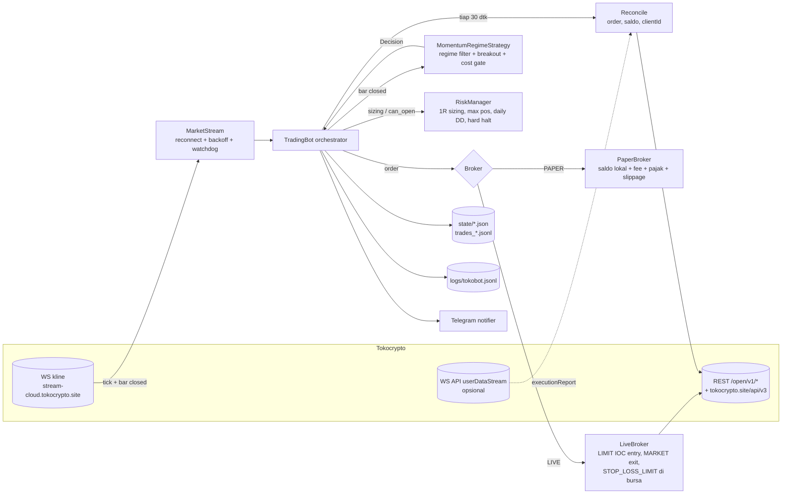

# TokoBot — Bot Spot Trading Tokocrypto (Python, asyncio)

Bot spot long-only untuk pair USDT di Tokocrypto: **volatility breakout + market regime filter**,
position sizing berbasis risiko tetap, kill-switch berlapis, rekonsiliasi state, dan tiga mode
(`BACKTEST` / `PAPER` / `LIVE`) yang memakai kode strategi dan risk manager yang **sama**.

> **Status: tidak direkomendasikan untuk uang riil.** Strategi bawaan **gagal** uji edge yang
> ditetapkan sebelumnya (batas bawah CI 95% −0,021R; lihat [Hasil evaluasi](#1-hasil-evaluasi)).
> Repo ini berguna sebagai kerangka eksekusi dan pipeline evaluasi yang jujur, bukan sebagai mesin profit.

---

## 1. Hasil evaluasi

Konfigurasi yang diuji (dibekukan sebelum uji): **timeframe 4h, stop 3×ATR, `MAX_COST_TO_RISK=0.25`**.
Biaya: fee akun 0,15% per sisi (terverifikasi via API), PPh final 0,21% di kedua sisi
([PMK 50/2025](https://www.pajak.go.id/artikel/pmk-502025-babak-baru-pemajakan-aset-kripto)), slippage 0,05%.

| Data uji (tidak dipakai saat memilih parameter) | Trade | Rata-rata R | PF |
|---|---|---|---|
| BTC/ETH 2018–2021 | 87 | +0,214 | 1,63 |
| SOL, BNB, XRP, ADA 2018–2026 | 279 | +0,073 | 1,18 |
| **Gabungan** (CI 95%, bootstrap per bulan entry, 81 cluster) | **366** | **+0,106** (−0,021 s/d +0,228) | – |

Kriteria lulus yang ditulis sebelum hasil: rata-rata > 0,1R **dan** batas bawah CI 95% > 0 → **GAGAL**.

Temuan utama:
- Edge kotor ada (±0,18–0,34R per trade), tetapi biaya memakan 0,10–0,12R per trade.
- Timeframe 1h tidak layak: edge kotor 0,05–0,12R vs biaya 0,17–0,28R.
- 2025 dan 2026 negatif di gabungan keenam aset (−0,05R dan −0,08R).
- Belum terverifikasi: apakah order BUY di pair USDT kena pajak. Bila tidak, satu run ulang diizinkan dan hasilnya final.

Mereproduksi uji keputusan:
```bash
BACKTEST_END=2022-01-01 BACKTEST_RESULTS_DIR=results/btc_eth_2018_2021 \
  python main.py --mode BACKTEST && \
SYMBOLS=SOL_USDT,BNB_USDT,XRP_USDT,ADA_USDT MAX_OPEN_POSITIONS=4 \
  BACKTEST_RESULTS_DIR=results/alts python main.py --mode BACKTEST && \
python scripts/bootstrap_ci.py \
  results/btc_eth_2018_2021/trades_BTC_USDT-ETH_USDT_4h_research.csv \
  results/alts/trades_SOL_USDT-BNB_USDT-XRP_USDT-ADA_USDT_4h_research.csv --cluster month
```

## 2. Fitur

- **Konektor Tokocrypto:** REST signed HMAC SHA256 + sinkronisasi waktu, rate limiter (token bucket + header
  `X-MBX-USED-WEIGHT-*` + `Retry-After` untuk 429/418), WebSocket kline dengan reconnect exponential backoff,
  watchdog data basi, rotasi koneksi sebelum batas 24 jam.
- **Presisi:** setiap order divalidasi (`Decimal`) terhadap `tickSize`, `stepSize`, `minNotional`, `PERCENT_PRICE`
  sebelum dikirim.
- **Idempotensi:** `clientId` deterministik per bar; timeout/5XX saat kirim order → dicari via `clientId`,
  tidak pernah dikirim ulang buta → tidak ada pembelian ganda.
- **Proteksi di bursa:** `STOP_LOSS_LIMIT` GTC aktif walau bot mati, plus watchdog exit market bila harga gap.
- **Rekonsiliasi** tiap 30 detik: entry yang statusnya belum pasti, status stop order, saldo vs posisi, order yatim.
- **Risk:** sizing 1R (biaya kedua sisi dihitung), maks posisi bersamaan, daily drawdown kill-switch,
  hard halt drawdown total, jeda loss beruntun, kill file manual.
- **Observability:** log JSON Lines berotasi + console, notifikasi Telegram non-blocking, heartbeat untuk healthcheck.
- **Evaluasi:** backtest portofolio tanpa look-ahead, tiga simulasi sebanding, breakdown per tahun, diagnostik
  biaya dalam R, sweep parameter, bootstrap CI ber-cluster.

## 3. Alur sistem



Siklus per bar (default **4h**):
1. **Tick** (±2 dtk): soft-stop / watchdog stop bursa, TP1 parsial.
2. **Bar close**: indikator dari 1000 bar terakhir → regime filter → trigger breakout → cost gate →
   `RiskManager.can_open` → sizing → `Broker.buy` → stop dipasang di bursa.
3. **Posisi terbuka**: trailing Chandelier diperbarui hanya saat bar close (sama dengan backtest).
4. **Risk loop** (5 dtk): mark-to-market → daily kill / hard halt / kill file.
5. **Reconcile loop** (30 dtk, LIVE).

## 4. Struktur direktori

```
tokobot/
├── main.py                        # orchestrator PAPER/LIVE + CLI (--status, --reset-halt)
├── config.py                      # konfigurasi immutable dari env, validasi silang
├── .env.example
├── core/models.py                 # Candle, Position, TradeRecord, FillResult
├── exchange/tokocrypto_client.py  # REST signed, rate limiter, MarketStream, UserDataStream, SymbolRules
├── data/
│   ├── indicators.py              # EMA, ATR, ADX, Donchian, Efficiency Ratio (kausal)
│   └── history.py                 # CSV load/save, resample
├── strategy/momentum_regime.py    # regime filter + sinyal + level stop/TP/trailing
├── risk/risk_manager.py           # sizing + kill-switch berlapis
├── execution/
│   ├── broker.py                  # PaperBroker, LiveBroker
│   └── state_store.py             # JSON atomic + jurnal trade
├── backtest/engine.py             # backtest portofolio, metrik, IS/OOS, unduh data
├── notify/telegram.py             # notifikasi async non-blocking
├── utils/logger.py                # console + JSON Lines berotasi
├── scripts/
│   ├── preflight.py               # konektivitas, aturan simbol, fee & pajak akun
│   ├── sweep.py                   # sweep parameter struktural (mode riset)
│   ├── bootstrap_ci.py            # CI expectancy, opsi --cluster month
│   └── make_synthetic_data.py     # data SINTETIS untuk smoke test
├── tests/                         # 35 test: unit, invariant backtest, mock bursa REST+WS, resilience
└── deploy/                        # Dockerfile, docker-compose.yml, tokobot.service
```

## 5. Quickstart

```bash
python3.12 -m venv .venv && source .venv/bin/activate
pip install -r requirements-dev.txt
cp .env.example .env && chmod 600 .env
pytest -q                                     # 35 test, tanpa jaringan
```

Simpan data dan hasil **di luar folder kode**, supaya update kode tidak pernah menghapusnya. Di `.env`:
```bash
BACKTEST_DATA_DIR=/path/ke/tokobot-data/historical
BACKTEST_RESULTS_DIR=/path/ke/tokobot-data/results
```

Unduh candle **4h asli bursa** (sama dengan yang dilihat bot live), lalu bekukan dengan checksum:
```bash
SYMBOLS=BTC_USDT,ETH_USDT,SOL_USDT,BNB_USDT,XRP_USDT,ADA_USDT TIMEFRAME=4h \
  python -m backtest.engine --download --start 2018-01-01
cd /path/ke/tokobot-data/historical && shasum -a 256 *.csv > SHA256SUMS && cd -

python main.py --mode BACKTEST
python scripts/preflight.py            # tambah --private bila API key terisi
python main.py --mode PAPER
```

Bila hanya CSV 1h yang ada, backtest membentuk 4h sendiri dan membuang candle 4h yang tidak lengkap.
Hasilnya bisa sedikit berbeda dari candle 4h bursa; untuk evaluasi, pakai data 4h asli.

## 6. Keputusan desain dan trade-off

| Keputusan | Alasan | Trade-off |
|---|---|---|
| Timeframe **4h**, stop **3×ATR** | Biaya round-trip ≈ **0,82%** (fee 0,15%×2 + PPh 0,21%×2 + slippage 0,05%×2). Di 1h, biaya > edge kotor. | ±19 trade/tahun per 2 aset; validasi live lambat. |
| **Cost gate** (`MAX_COST_TO_RISK=0.25`, `MIN_REWARD_COST_RATIO=3`) | Sinyal dibuang bila biaya > 25% jarak stop atau TP1 < 3× biaya. | Sinyal berkurang saat volatilitas rendah. |
| Regime filter berlapis (EMA, ADX naik, Efficiency Ratio, band ATR%) | Mengurangi entry di pasar choppy dan false wick. | Terlambat di awal tren; banyak parameter = risiko overfit. |
| Entry **LIMIT IOC** di ask×(1+0,3%) | Slippage terbatasi; tidak ada order menggantung. | Bisa tidak terisi saat pasar cepat. |
| Exit **MARKET** | Kepastian keluar lebih penting dari harga. | Slippage pada aset tipis. |
| **STOP_LOSS_LIMIT** di bursa + watchdog | Proteksi aktif walau VPS mati. | Gap melewati limit → watchdog jual market. |
| Qty bersih dari **selisih saldo** | Tidak bergantung aset komisi. | Wajib akun/sub-akun khusus bot; order serial lewat satu lock. |
| `clientId` deterministik + `pending_entries` dipersist | Tidak ada double-entry setelah timeout/5XX. | Order yang benar-benar hilang dilepas setelah 15 menit. |
| Daily DD dari ekuitas **termasuk unrealized** | Lebih konservatif. | Kill-switch bisa aktif oleh fluktuasi yang lalu pulih. |
| Pajak **di dua sisi** (default) | Pair USDT = pertukaran dua aset kripto; konservatif. | Mungkin melebihkan biaya; verifikasi `taxRate` dari trade BUY. |

## 7. Asumsi yang perlu diverifikasi

Kode diuji terhadap **mock** yang meniru format apidocs, belum terhadap order riil di server Tokocrypto.

1. **Pajak sisi beli** — lakukan satu trade kecil manual, lalu `python scripts/preflight.py --private` untuk melihat `taxRate` di trade BUY.
2. **Fee** — akun VIP0 yang diverifikasi: 0,15% maker dan taker. Preflight memberi peringatan bila akun Anda berbeda.
3. **`STOP_LOSS_LIMIT` per simbol** — preflight menampilkan dukungannya; bila tidak ada, bot memakai soft-stop.
4. **Rate limit** — apidocs tidak menyebut angka; default konservatif 600 weight/menit.
5. **User data stream (listenToken)** — default `USE_USER_STREAM=false`; REST reconcile tetap sumber kebenaran.
6. **symbolType** — hanya type 1 yang didukung.
7. **Stop terisi sebagian** — qty disesuaikan dari saldo, tetapi PnL leg parsial tidak tercatat presisi.

## 8. Checklist pengujian → deployment

### Tahap 0 — Sanity lokal
- [ ] `pytest -q` lulus (35 test), `python -m mypy --ignore-missing-imports .` dan `python -m pyflakes .` bersih.

### Tahap 1 — Backtest

`python main.py --mode BACKTEST` menjalankan tiga simulasi pada data dan periode yang sama:

| Blok | Biaya | Circuit breaker | Dipakai untuk |
|---|---|---|---|
| **[1] Edge strategi** | ON | OFF | Menilai edge di seluruh periode, per tahun, IS/OOS |
| **[2] Tanpa biaya** | OFF | OFF | Edge kotor; selisih dengan [1] = drag biaya |
| **[3] Risk guard** | ON | ON | Perilaku live: kapan halt/pause terjadi |

- [ ] Pilih parameter hanya dari data seleksi (mis. `scripts/sweep.py` di 2022–2026), lalu **bekukan**.
- [ ] Tulis kriteria lulus **sebelum** menguji di data yang belum dipakai (periode lain, aset lain).
- [ ] Nilai dengan `scripts/bootstrap_ci.py --cluster month`: batas bawah CI 95% gabungan > 0.
- [ ] Bagian "OOS" bawaan laporan hanya bermakna bila periode itu tidak dipakai saat memilih parameter.
- [ ] Koreksi hanya berdasarkan fakta terverifikasi (fee/pajak dari akun), bukan untuk mencari hasil lebih bagus.

### Tahap 2 — Pre-flight
- [ ] API key khusus bot: **Trade ON, Withdraw OFF, whitelist IP VPS**; idealnya sub-akun terpisah.
- [ ] `python scripts/preflight.py --private` → LULUS; offset jam < 1000 ms.

### Tahap 3 — Paper trading
- [ ] `TRADING_MODE=PAPER`, Telegram aktif; uji ketahanan: putus jaringan, restart saat posisi terbuka, `touch state/KILL`.
- [ ] Untuk membuktikan edge ke depan: tetapkan kriteria sekarang (mis. ≥ 150 trade dan batas bawah CI > 0).

### Tahap 4 — LIVE modal kecil (hanya bila uji edge lulus)
- [ ] `LIVE_CONFIRM=I_UNDERSTAND_REAL_MONEY_RISK`, `CAPITAL_CAP_QUOTE` kecil, `RISK_PER_TRADE=0.005`.
- [ ] Aturan berhenti ditetapkan di awal (mis. setelah 30 trade, rata-rata < −0,2R → hentikan).

### Tahap 5 — Deployment VPS Linux

**systemd**
```bash
sudo useradd --system --create-home --home-dir /opt/tokobot tokobot
sudo -u tokobot git clone <repo> /opt/tokobot
cd /opt/tokobot && sudo -u tokobot python3.12 -m venv .venv && sudo -u tokobot .venv/bin/pip install -r requirements.txt
sudo -u tokobot cp .env.example .env && sudo chmod 600 .env
sudo -u tokobot mkdir -p state logs
sudo cp deploy/tokobot.service /etc/systemd/system/ && sudo systemctl daemon-reload
sudo systemctl enable --now tokobot && journalctl -u tokobot -f
```

**Docker**
```bash
mkdir -p state logs && chmod 600 .env
docker compose -f deploy/docker-compose.yml up -d --build
```

Operasional: sinkronisasi waktu (chrony), firewall outbound 443 + SSH, backup `state/` harian,
stop darurat `touch state/KILL` → `systemctl stop tokobot` (stop di bursa tetap aktif),
reset setelah hard halt `python main.py --mode LIVE --reset-halt`.

## 9. Catatan

- Kode dan desain metodologi dikembangkan bersama asisten AI (Claude); run backtest, verifikasi akun, dan keputusan dilakukan oleh pemilik repo.
- Bukan nasihat keuangan. Hasil backtest tidak menjamin hasil di masa depan.
- Referensi: [Tokocrypto API docs](https://www.tokocrypto.com/apidocs/).
